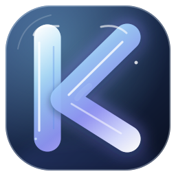

# Klar

### Browse with clarity.

A modern, glass-inspired desktop browser built with Electron, Chromium, React, and TypeScript.

[**View source**](https://github.com/GDSlash/Klar) · [**Report a bug**](https://github.com/GDSlash/Klar/issues) · [**Build workflow**](https://github.com/GDSlash/Klar/actions)

---

## About

Klar is an open-source desktop browser project focused on a calm interface and straightforward browsing. It combines a custom React interface with Chromium-powered web views inside an Electron desktop application.

Klar is in **early development (0.1.0 preview)**. The core shell and multi-tab navigation are being built first; some browser features and platform packaging still need implementation and testing.

## Current features

- **Multi-tab browsing** — create, switch between, and close independent browser tabs.
- **Navigation controls** — back, forward, reload, and address-bar navigation.
- **Search fallback** — enter a search phrase or a web address in the address bar.
- **Keyboard shortcuts** — quick access to common browser actions.
- **Glass-inspired interface** — dark surfaces, translucent panels, and soft blue-violet highlights.
- **Cross-platform build pipeline** — GitHub Actions is configured to build on Windows, macOS, and Linux.

### Keyboard shortcuts

| Action | Windows / Linux | macOS |
|---|---|---|
| Focus address bar | Ctrl + L | ⌘ + L |
| New tab | Ctrl + T | ⌘ + T |
| Close active tab | Ctrl + W | ⌘ + W |
| Reload page | Ctrl + R | ⌘ + R |
| Switch tabs | Ctrl + Tab | ⌘ + Tab |
| Previous / next page | Alt + ← / → | Alt + ← / → |

## How Klar works

Klar is a desktop application with two main sides: the interface you interact with and the Chromium-powered page views that display websites.

\`\`\`text
┌──────────────────────────────────────────────┐
│                Klar desktop app              │
│                                              │
│  React + TypeScript UI                       │
│  Tabs · Toolbar · Address bar · Sidebar      │
│                  │                           │
│          Secure preload bridge               │
│          (contextBridge + IPC)                │
│                  │                           │
│            Electron main process             │
│       Window · Tab lifecycle · Navigation    │
│                  │                           │
│       Chromium WebContentsView per tab       │
│             Actual web pages                 │
└──────────────────────────────────────────────┘
\`\`\`

1. **Electron** creates the native desktop window and runs the main process.
2. **React and TypeScript** render Klar's browser chrome: tabs, toolbar, address bar, and new-tab screen.
3. **The preload bridge** exposes a small, explicit API to the UI using Electron's \`contextBridge\` and IPC. The renderer does not get direct Node.js access.
4. **Electron's \`WebContentsView\`** hosts each tab's web content. Each tab has its own Chromium webContents, so switching tabs switches the visible page.
5. **Chromium** does the actual website rendering, JavaScript execution, networking, and browser page work.

### Technology

| Technology | Role |
|---|---|
| Electron | Desktop application shell and native APIs |
| Chromium | Web rendering and page execution |
| React | Browser interface |
| TypeScript | UI type safety |
| Vite | Renderer development server and bundler |
| electron-builder | Packaging desktop builds |
| GitHub Actions | Automated cross-platform build jobs |

## Building

### Requirements

- Node.js 22 or newer
- npm
- Git

### Run in development

\`\`\`bash
git clone https://github.com/GDSlash/Klar.git
cd Klar
npm install
npm run dev
\`\`\`

### Create a production build

\`\`\`bash
npm run dist
\`\`\`

Platform-specific packaging scripts are also available:

\`\`\`bash
npm run dist:win
npm run dist:mac
npm run dist:linux
\`\`\`

Builds should be packaged on the corresponding operating system. The GitHub Actions workflow runs separate Windows, macOS, and Linux jobs and uploads build artifacts when successful.

> **Note:** Klar is a preview project, not yet a signed or notarized public release. Unsigned builds may trigger operating-system security warnings. Build artifacts are not the same as a stable release.

## Roadmap

- [x] Electron + React application foundation
- [x] Chromium-backed web view per tab
- [x] Basic tab creation, switching, and closing
- [x] Back, forward, reload, and address navigation
- [x] Cross-platform CI build workflow
- [ ] Persistent tabs and session restore
- [ ] Bookmarks that can be saved and managed
- [ ] Browsing history
- [ ] Downloads manager
- [ ] Settings and privacy controls
- [ ] More complete keyboard shortcuts and accessibility
- [ ] Signed, tested releases for supported platforms

## Contributing

Klar is early in development, and feedback is welcome. Open an [issue](https://github.com/GDSlash/Klar/issues) to report a bug or suggest an improvement. Before submitting a pull request, please describe the change and test it on the platform you are targeting.

## License

Klar is licensed under the [MIT License](LICENSE). You may use, copy, modify, merge, publish, distribute, sublicense, and/or sell copies of the software, subject to the license terms.

---

**Klar — Browse with clarity.**

Made with care. Built in the open.

